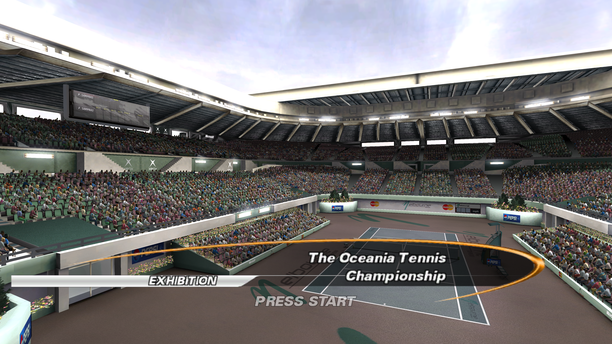

# Max Spin

**Top Spin for PC, rebuilt from the original Xbox game.** Max Spin is a native recompilation for **Windows and Linux**, maintained by **djultra64**, with modern graphics options and controls adapted to today's controllers.

*Captured from our Linux build at 3840 × 2160. Click the image for full resolution.*

## Features

- **Native Windows and Linux builds** using SDL3 and Vulkan.
- **4K rendering and 16:9 widescreen**, including full-width loading artwork and corrected menu spacing.
- **60 FPS frame cap by default.**
- **Antialiasing and sprite filtering**, with Original, Super-xBR 2x and Super-xBR 4x options for supported 2D sprites.
- **Xbox, PlayStation and Nintendo Switch glyphs**, selected automatically from the active controller, with a manual family selector.
- **Controls mapped by action and physical position**, including Nintendo's A/B and X/Y layout, keyboard support and optional action remapping.
- **In-game Graphics Options** for resolution, antialiasing, sprite filtering, display mode and controller prompts.
- **Windowed and fullscreen output**, with a persistent game window and shared preferences across mode transitions.
- **Separate save and graphics settings folders**, keeping personal progress independent of display preferences.

## Getting started

1. Download the package for your platform from [Releases](https://github.com/djultra64/Max-Spin/releases/latest).
2. Supply your own extracted Top Spin game files and prepare the local resources with Python 3, following the [installation guide](docs/install.md).
3. Start **MaxSpin.exe** on Windows or **MaxSpin.sh** on Linux.

See [controls](docs/controls.md), [graphics settings](docs/graphics.md) and [troubleshooting](docs/troubleshooting.md) for setup details. To compile the project yourself, follow the [source build instructions](docs/build.md).

## Bringing the Xbox game to PC

The original game ties its menus, graphics and transitions to Xbox hardware. Max Spin recompiles the game code and connects it to a native PC runtime, adapting rendering, input and window management along the way.

That work includes keeping one window across game modes, matching button prompts to each controller's actual layout, repositioning menu footers and stretching the loading artwork to 16:9 while preserving the ball's alignment. Prepared local resources carry these interface changes while keeping the original game files intact. More about the [UI and loading improvements](docs/ui-layout-20261025.md).

## Credits and licensing

Max Spin integration and project work: **djultra64**. The original game remains the work of its respective creators and rights holders. This independent project is not affiliated with or endorsed by them.

Original project code is available under the [MIT license](LICENSE). Bundled dependencies retain their own licenses; see [third-party notices](THIRD_PARTY.md). The project license does not cover the original game. AI assistance is described in [AI_DISCLOSURE.md](AI_DISCLOSURE.md).
